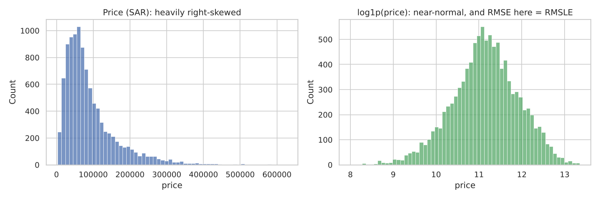
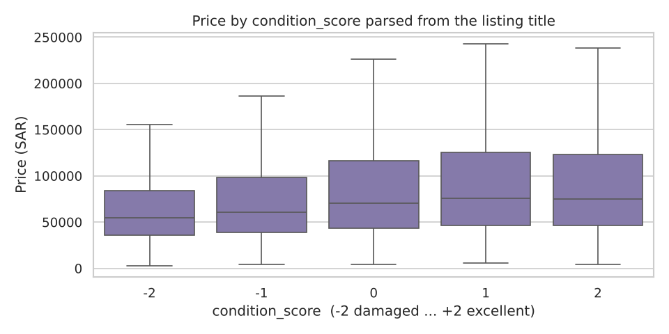
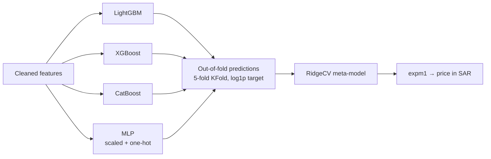
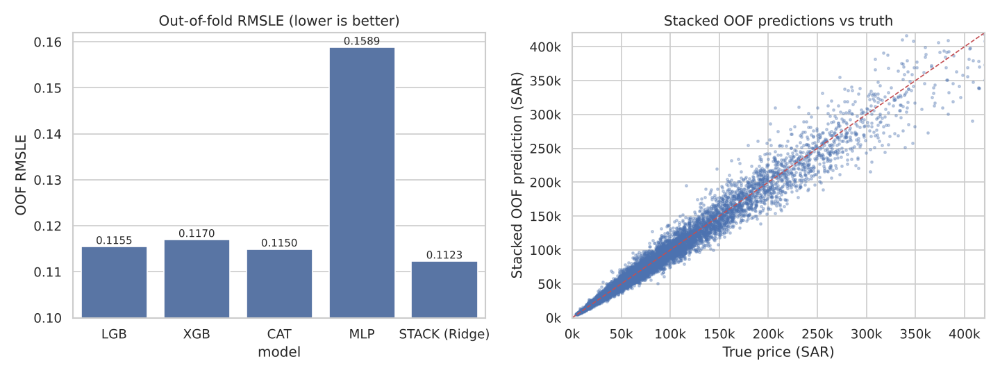

# 🚗 Saudi Used-Car Price Prediction — 3rd Place Solution

**3rd place** in *"How Much Is Your Car Worth?"*, an in-person, 4-hour Kaggle competition organised by the **Elm Student Club** (Riyadh, November 2026).

The task: predict the listing price (SAR) of used cars in Saudi Arabia from messy, bilingual (Arabic/English) marketplace data. The metric is **RMSLE**.

| | |
|---|---|
| 🏆 Final rank | **3rd** / `[N]` teams |
| 📉 Private leaderboard RMSLE | `[0.xxxxx]` |
| 📊 Public leaderboard RMSLE | `[0.xxxxx]` |
| ✅ Local 5-fold OOF RMSLE (stack) | **0.1123** |
| ⏱️ Time limit | 4 hours, laptop only |

---

## The problem

~10.5k training listings and 5k test listings with 12 raw features: brand, model, model year, mileage, transmission, trim, specs, city, seller type, listing date, color and a free-text **title**.

The data is semi-synthetic and deliberately dirty, the way real listings look on Saudi marketplaces. Most of the gain came from cleaning it correctly:

| Data trap | Rows affected (train) | Fix |
|---|---|---|
| Model year in the **Hijri** calendar (e.g. `1445`) | 548 | `year × 0.970224 + 621.57` |
| Mileage as text: `70000 km`, `63,000`, **Arabic-Indic digits** `٢٠٠٠` | 1,503 | Translate digits, strip non-digits |
| **46 spellings** of 10 cities (`Riyadh`, `riyad`, `الرياض`, …) | all | Canonical mapping |
| Hidden nulls `-` and `غير محدد` ("not specified") | 1,044 | → own `Unknown` category |
| Placeholder prices of 0 or 1 SAR | 250 | Dropped from training |
| Duplicate re-posted listings | 300 | Dropped from training |
| Missing `trim` | 215 | Recovered from the title (99.3% precise when the title mentions it) |

<p align="center"></p>

## Approach

### 1. Feature engineering ([`src/features.py`](src/features.py))
- **Age:** fractional `exact_age` from the listing date, plus `car_age`.
- **Usage:** `log_mileage`, `km_per_year`, and mileage relative to the median mileage of cars of the same age (fitted on train only).
- **Title NLP (Arabic + English regex):** `is_damaged`, `has_minor_accident`, `is_very_clean`, `is_excellent` → a single `condition_score`.
- **Domain:** `brand_model` combination, `is_luxury`, ordinal trim.

<p align="center"></p>

### 2. Model: 2-level stacking ([`src/train.py`](src/train.py))



- All models train on `log1p(price)`, so minimising RMSE **is** minimising the competition's RMSLE.
- **Level 1:** each model is trained once per fold; its predictions on the held-out fold form an *out-of-fold* matrix that no model saw during training. Test predictions are averaged over the 5 folds.
- **Level 2:** a Ridge regression on those 4 OOF columns learns how much to trust each model. The L2 penalty keeps the weights stable even though the base models are highly correlated.
- Tree models use native categorical handling; CatBoost's ordered target statistics made it the strongest single model.

### 3. Results (5-fold out-of-fold RMSLE)

| Model | OOF RMSLE | Meta weight |
|---|---|---|
| LightGBM | 0.1155 | 0.31 |
| XGBoost | 0.1170 | 0.17 |
| CatBoost | **0.1150** | 0.47 |
| MLP | 0.1589 | 0.05 |
| **Stack (RidgeCV)** | **0.1123** | — |

<p align="center"></p>

> **Note on reproducibility.** The notebook submitted during the competition scored 0.1126 OOF. While cleaning the code for this repo I fixed two bugs found in review: the MLP was trained on unscaled numeric features (OOF RMSLE 5.18, so the stack ignored it), and LightGBM's row subsampling was silently off (`subsample_freq` was 0). This version is slightly better at 0.1123.

## Repository structure

```
├── notebooks/
│   └── solution.ipynb     # full walkthrough: data traps → features → stacking → submission
├── src/
│   ├── features.py        # cleaning + feature engineering
│   └── train.py           # stacking ensemble, CLI that writes a submission
├── assets/                # figures used in this README
├── data/                  # put the competition CSVs here (not committed)
├── submissions/           # generated submission files (not committed)
├── requirements.txt
└── LICENSE
```

## How to run

```bash
git clone https://github.com/rayancis/saudi-used-car-price-prediction.git
cd saudi-used-car-price-prediction
pip install -r requirements.txt
```

**Get the data.** The competition data is not redistributed here. Download `train.csv`, `test.csv` and `sample_submission.csv` from the competition's Data tab (you need to have joined the competition) and place them in `data/`:

```bash
kaggle competitions download -c <competition-slug> -p data && unzip data/*.zip -d data
```

**Train and create a submission** (≈2–3 minutes on a 4-core CPU):

```bash
python src/train.py --data-dir data --out submissions/submission.csv --folds 5
```

Or open `notebooks/solution.ipynb` and run all cells.

## What I would try next
- Multi-seed / repeated K-fold for the base models.
- Out-of-fold target encoding of `brand_model` and price-per-age group statistics.
- TF-IDF character n-grams on the title as a fifth (linear) base model.
- Adversarial validation to detect train/test shift before it reaches the private leaderboard.

## Acknowledgements
Thanks to the **Elm Student Club** for organising the competition. The dataset belongs to the organisers and is used under the competition rules.

## License
Code released under the [MIT License](LICENSE).
